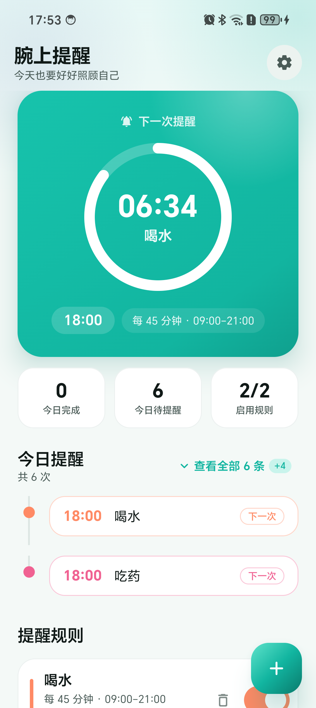
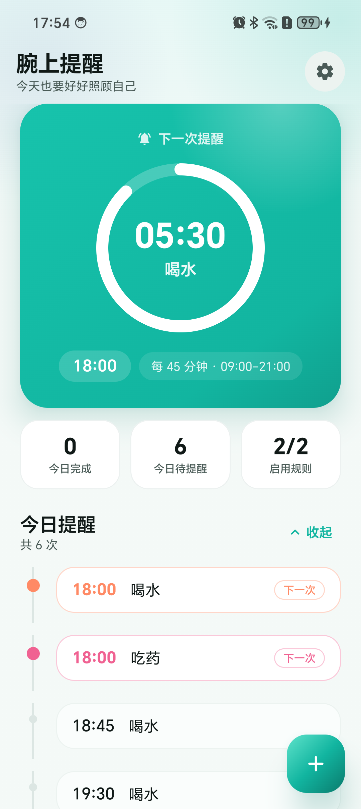
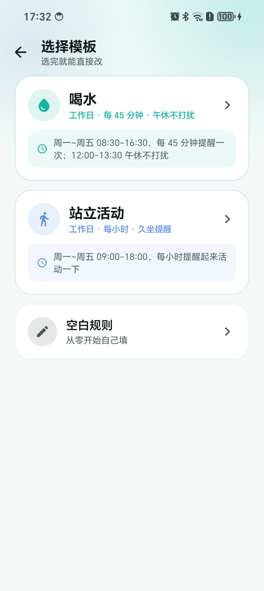
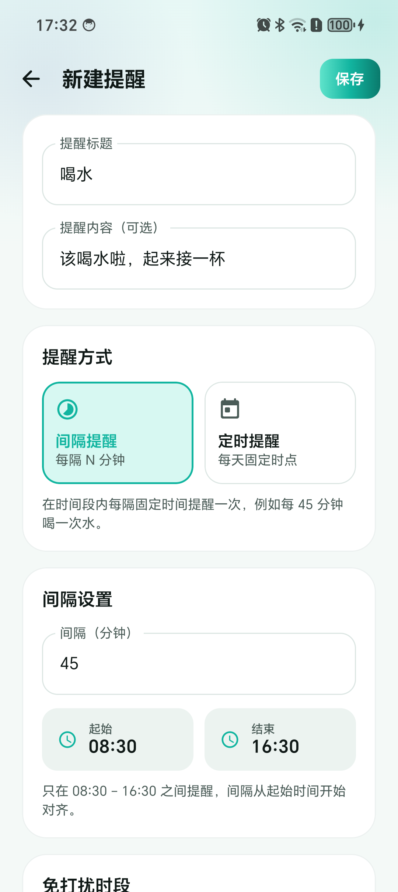
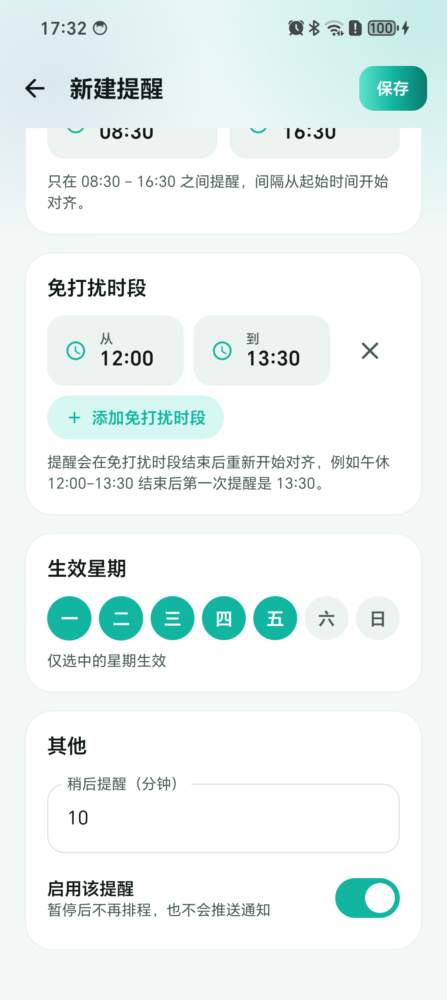
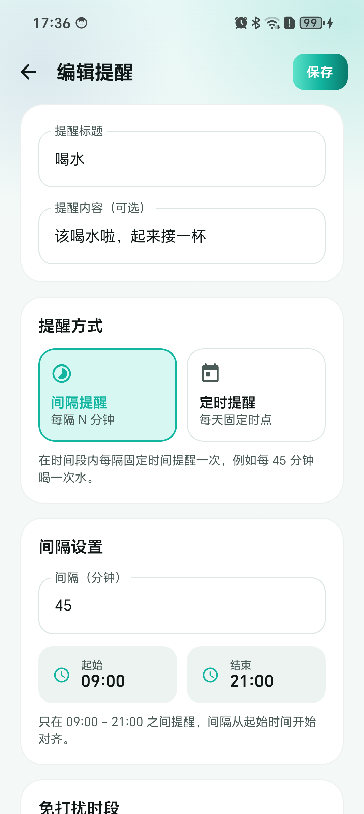
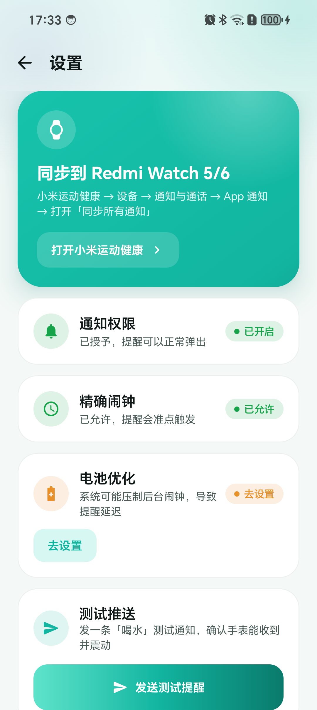
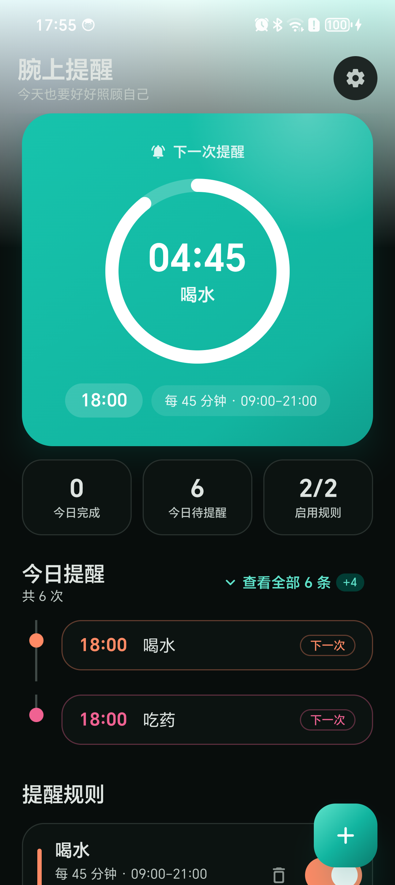

# 腕上提醒 BandRemind

给 **Redmi Watch 5 / 6** 用的定时提醒 App：喝水、吃药、久坐、活动眼睛……到点手表震动提醒。

Android 原生 Kotlin + Jetpack Compose，无账号、无网络请求、无广告。



| 首页 | 今日提醒（展开） | 模板选择 |
|---|---|---|
|  |  |  |

| 模板预填 | 免打扰时段 | 编辑已有规则 |
|---|---|---|
|  |  |  |

| 设置 | 深色模式 |
|---|---|
|  |  |

> **真机验证覆盖两台设备**：
> - **华为 Mate 60 Pro（CLK-AN00 / Android 14）**：6 项真机 UI 测试全过 —— 折叠只显示两条、展开全部、再点收起、
>   新建进模板页、喝水/站立两个模板的预填参数，全部由真实点击驱动。
> - **小米手机（HyperOS / Android 16）**：完成端到端验证 —— 规则排程 → 精确闹钟到点触发 → 高优先级通知投递，全部正常。
>
> 详细验证结论见文末「真机验证记录」。

---

## 下载安装

当前版本 **0.0.1**，从 [Releases 页面](https://github.com/lizl143772/BandRemind/releases) 下载 `BandRemind-0.0.1.apk`。

| 项目 | 要求 |
|---|---|
| 系统版本 | Android 8.0（API 26）及以上 |
| 架构 | 全部（universal APK） |
| 权限 | 通知、精确闹钟、开机自启、忽略电池优化 |

安装步骤：下载 APK → 允许「安装未知来源应用」→ 点安装 → 打开后授予通知权限 → 进「设置」页把精确闹钟和电池优化也处理掉。

> 手表端震动还需要在**小米运动健康 → 设备 → 通知与通话 → App 通知 → 同步所有通知**里打开，
> 打开后本 App 的通知不需要加白名单就会自动镜像到 Redmi Watch 5/6。

---

## 界面

- **渐变主卡 + 倒计时圆环**：首页顶部是一张品牌渐变卡，圆环实时显示「距下一次提醒还剩多少」，
  弧长 = 从上一次触发到下一次触发已经走过的比例，每秒平滑推进。
- **今日时间线**：竖向轨道 + 圆点串起今天的每一次提醒，下一次那条高亮描边。
  默认只显示**最近两条**，点标题行右侧的「查看全部 N 条」展开全部，再点「收起」折回。
  切换按钮固定在标题行 —— 今天哪怕有 40 多次提醒，也不用滚到列表末尾才能收起。
- **统计条**：今日完成 / 今日待提醒 / 启用规则，三个数一眼看完。
- **规则卡**：每条规则按 id 分配一个稳定的点缀色（色条 + 开关 + 「下次 xx:xx」标签）。
- **模板选择页**：新建规则先选模板（喝水 / 站立活动 / 空白），进去后参数全部可改。
- **完整深色模式**：独立配色，不是简单反色。
- **顶栏极简**：只有标题 + 副标题，背景用品牌色辉光做层次。

设计令牌集中在 [`ui/theme/Theme.kt`](app/src/main/java/com/lizl/bandremind/ui/theme/Theme.kt)：
品牌色阶、点缀色板、字阶、圆角体系、状态色。改配色只动这一个文件。

---

## 它是怎么把提醒送到手表上的

Redmi Watch 5/6 跑的是 HyperOS 2 / Vela，**可以直接装独立快应用**，理论上可以让手表自己离线提醒。
但本项目第一版刻意走了另一条路：

```
规则引擎  ──►  调度层  ──►  投递层  ──►  手机通知  ──►  小米运动健康  ──►  手表震动
             AlarmManager   高优先级        自动镜像
             精确闹钟      本地通知
```

**为什么不在手表端装快应用？**

| | 手机端通知镜像（本项目） | 手表端快应用 |
|---|---|---|
| 开发门槛 | 一个普通 Android App | 需要 Vela 工具链 + 逐机型适配 |
| 离线可用 | ❌ 手机不在身边就收不到 | ✅ |
| 手表端耗电 | 无 | 需要自行控制定时器唤醒 |
| 表盘/应用入口 | 只是通知 | 可做独立界面 |

第一版用最稳的路径把「能用的提醒」跑通；后面想加离线提醒时，可以按 `ReminderNotifier` 的接口再挂一条 Vela 通道，两种投递并存。

小米官方 FAQ 对 Redmi Watch 5 的说明里明确写着：

> 開啟[小米運動健康] >> [設備] >> [通知與通話] >> [App 通知]並啟用。**您可以選擇[同步所有通知]，將所有手機APP的通知同步到手錶**，或選擇特定APP。

也就是说 **「同步所有通知」打开后，本 App 的通知不需要加白名单就会自动出现在手表上**。

---

## 功能

- **两种提醒方式**
  - *间隔提醒*：在时间窗内每隔 N 分钟提醒一次（例如每 45 分钟喝水，09:00–21:00）
  - *定时提醒*：每天在固定几个时点提醒（例如 08:00 / 12:00 / 18:00 吃药）
- **免打扰时段**：时间窗内可以挖掉几段不打扰（例如喝水 08:30–16:30，12:00–13:30 午休不提醒）。
  被挖掉的时间窗会拆成「活动片段」，每段各自对齐自己的起点 —— 午休一结束（13:30）立刻恢复提醒，
  而不是等到下一个 45 分钟刻度 13:45。
- **内置模板**：新建规则先进模板选择页
  | 模板 | 规则 |
  |---|---|
  | 喝水 | 周一~周五 08:30–16:30，每 45 分钟一次，12:00–13:30 午休不提醒 |
  | 站立活动 | 周一~周五 09:00–18:00，每小时提醒一次 |
  | 空白规则 | 从零开始自己填 |

  选完模板进编辑页，**所有参数都能改**。
- **按星期生效**：可以只让「吃药」在工作日提醒
- **今日提醒折叠**：默认只显示最近两条，可一键展开全部
- **下次提醒倒计时** + 今日时间线
- **通知上直接操作**：✅ 已完成 / ⏰ 稍后提醒（可设分钟数）
- **完成情况统计**：当天完成了几次
- **开机 / 换时区后自动重建闹钟**
- **权限体检页**：通知权限、精确闹钟、电池优化三项状态一目了然，可一键跳转修复
- **测试推送**：一键发一条「喝水」，确认手表能收到

---

## 构建

环境要求：JDK 17、Android SDK（compileSdk 35 + build-tools 35.0.0）

```bash
# 在项目根目录
./gradlew.bat :app:assembleDebug        # Windows
./gradlew :app:assembleDebug             # macOS / Linux

./gradlew.bat :app:assembleRelease       # 出可安装的正式包
./gradlew.bat :app:testDebugUnitTest     # 跑纯逻辑单元测试
```

产物：`app/build/outputs/apk/debug/app-debug.apk`、`app/build/outputs/apk/release/app-release.apk`

> `local.properties` 需要指向本机 SDK，例如 `sdk.dir=E\:\\AndroidStudio\\sdk`

### release 签名

正式包用项目自带的证书签名，签名配置放在**仓库根目录的 `keystore.properties`**，
私钥 `bandremind-release.jks` 一并被 `.gitignore` 排除，不进版本库：

```properties
storeFile=bandremind-release.jks
storePassword=...
keyAlias=bandremind
keyPassword=...
```

- 没有这两个文件时，`assembleRelease` 仍能编过，但产出的是**未签名**包，装不上手机。
- 证书指纹（SHA-256）：`67:B1:69:88:FA:51:E6:9A:A5:D4:E4:58:91:52:46:72:E2:50:48:20:82:DD:2B:6F:3E:72:85:42:9E:95:C1:65`
- 后续版本请用同一份签名，否则用户无法覆盖升级。

---

## 使用步骤

### 1. 安装并授权

首次启动会申请通知权限。到「设置」页把下面三项都处理掉：

| 项目 | 为什么 | 状态异常的后果 |
|---|---|---|
| 通知权限 | 发提醒 | 根本不弹 |
| 精确闹钟 | 准点触发 | 只能粗略触发，可能延迟几分钟 |
| 电池优化 | Doze 下不被压制 | 息屏几小时后提醒可能迟到 |

### 2. 打开手表的「同步所有通知」

**小米运动健康** → 设备 → 通知与通话 → **App 通知** → 打开 **同步所有通知**

也可以只选本 App 单独授权，但「同步所有通知」更省事。

建议同时在手表端确认：

- 关闭**勿扰模式**（否则不震动）
- 打开**亮屏提醒**（可选，手表会亮屏显示内容）
- 佩戴模式选「始终」或「仅佩戴时」按需调整

### 3. 建规则

首页右下角 **+** 新建 → 先进入**模板选择页**：

```
喝水        周一~周五 08:30-16:30，每 45 分钟提醒一次；12:00-13:30 午休不打扰
站立活动    周一~周五 09:00-18:00，每小时提醒起来活动一下
空白规则    从零开始自己填
```

选完模板进编辑页，参数已经填好，**可以继续改成任何样子**：

```
标题：喝水
方式：间隔提醒
间隔：45 分钟
时间窗：08:30 – 16:30
免打扰时段：12:00 – 13:30
生效日：周一 ~ 周五
```

### 4. 验证

设置页 → **发送测试提醒**。手表应该震动并显示「喝水」。

### 深链（可选）

支持用 `adb` 或桌面快捷方式直接跳到某个页面：

```bash
adb shell am start -a android.intent.action.VIEW -d "bandremind://settings"
adb shell am start -a android.intent.action.VIEW -d "bandremind://templates"
adb shell am start -a android.intent.action.VIEW -d "bandremind://edit"
adb shell am start -a android.intent.action.VIEW -d "bandremind://edit?template=water"
adb shell am start -a android.intent.action.VIEW -d "bandremind://edit?template=stand"
```

---

## 架构

```
com.lizl.bandremind
├── data/          规则模型 + DataStore 持久化
│   ├── Reminder.kt            规则与完成记录的数据结构
│   ├── ReminderCodec.kt       JSON 编解码（java.time ↔ 可序列化类型）
│   └── ReminderRepository.kt  DataStore 读写
├── logic/
│   ├── NextTriggerCalculator.kt  纯函数，算下一次/上一次触发时刻、进度与活动片段（可单测）
│   └── TimelinePolicy.kt         今日提醒的折叠/展开策略（纯函数，可单测）
├── schedule/
│   └── ReminderScheduler.kt   AlarmManager 精确闹钟排程
├── notify/
│   └── ReminderNotifier.kt    高优先级通知渠道与通知构造
├── receiver/
│   ├── ReminderAlarmReceiver.kt  闹钟到点 → 发通知 → 挂下一次
│   ├── ReminderActionReceiver.kt 「已完成」/「稍后提醒」
│   └── BootReceiver.kt          开机/改时间后重建闹钟
└── ui/               Compose 界面
    ├── HomeScreen.kt       下一次提醒 + 今日时间线（可折叠）+ 规则列表
    ├── TemplateScreen.kt   新建前的模板选择页
    ├── RuleTemplates.kt    内置模板定义（喝水 / 站立活动）
    ├── RuleEditScreen.kt   规则编辑器（含免打扰时段）
    ├── SettingsScreen.kt   权限体检 + 测试推送
    ├── Components.kt       共用视觉组件（渐变卡、倒计时圆环、状态胶囊…）
    ├── ReminderApp.kt      导航（含深链）
    ├── ReminderViewModel.kt
    └── theme/Theme.kt      设计令牌：色板、字阶、圆角、状态色
```

测试：

```
app/src/test/          JVM 单元测试（触发时刻算法、活动片段、模板参数、折叠策略）— 46 项
app/src/androidTest/   真机 UI 测试（今日提醒折叠/展开、模板页、模板预填）— 6 项
```

真机 UI 测试不依赖 `ActivityScenario`（国产 ROM 会拦进程内启动 Activity），
而是用 `UiAutomation.executeShellCommand` 以 shell 身份打开页面并注入真实点击，
再从无障碍树里读渲染出来的文字。

### 几个关键设计

**每条规则只挂一个闹钟。**
闹钟触发 → 发通知 → 用当前时间重新算下一次 → 挂上。链式推进。
这样「每 45 分钟」不会因为一次性挂几十个闹钟而漏触发，也没有累积漂移。

**用 `setAlarmClock` 而不是 `setExact`。**
`setAlarmClock` 在 Doze 下依然准时，状态栏会显示下一个闹钟（对用户是个有用的提示），
且系统不会因为省电把它丢掉。拿不到精确闹钟权限时自动降级为 `setAndAllowWhileIdle`。

**触发时刻严格取「晚于当前时间」。**
`NextTriggerCalculator.next()` 用的是 `isAfter(from)`。闹钟触发后重新排程时，
当前时间已经过了触发点，所以不会立刻重复触发同一个时刻。

**倒计时进度是算出来的，不是估的。**
`progress()` = (当前时间 − 上一次触发) ÷ (下一次触发 − 上一次触发)。
为此额外实现了 `previous()`，用来反推上一次触发时刻 —— 间隔提醒退回窗口内最后一个刻度，
定点提醒退回当天更早的那个时点。

**规则用 JSON 整体存储。**
规则数量是个位数到几十，整体读写比拆成多个 DataStore key 更不容易出现部分写入导致的不一致。

**免打扰时段用「活动片段」建模，而不是「跳过落在免打扰里的刻度」。**
时间窗 08:30–16:30 扣掉午休 12:00–13:30，得到两段活动片段：
`[08:30–12:00]` 和 `[13:30–16:30]`。间隔在**每段内部各自对齐段起点**：

```
第一段  08:30 09:15 10:00 10:45 11:30
—— 午休 12:00–13:30 ——
第二段  13:30 14:15 15:00 15:45 16:30
```

这样午休结束（13:30）当刻就恢复提醒，符合直觉；
如果按「跳过 12:00/12:45/13:15 这些刻度」算，午休后第一次提醒会拖到 13:45，反而更晚。
片段算法在 `NextTriggerCalculator.activeSegments()`，纯函数，有单测覆盖。

---

## 已知限制

- **手机不在身边就没有提醒**。这是「手机端排程 + 通知镜像」路线的固有代价。
  想要真正离线提醒，需要开发手表端快应用（Vela），本项目未包含。
- **手表端只能看，不能操作**。Redmi Watch 5 的通知镜像不支持在手表上回复/操作按钮。
- **手表最多保留最近 10 条消息**（小米官方限制）。
- **勿扰模式**下手表不震动。
- 提醒的**标题**会原样显示在手表通知上，所以标题建议写成「喝水」这种短词。

---

## 真机验证记录

### 一、华为 Mate 60 Pro（CLK-AN00 / Android 14 / SDK 34）

当前主力验证设备，**界面交互全部由真实点击驱动**（`adb shell input tap/swipe` 以 shell 身份注入）：

| 验证项 | 方法 | 结果 |
|---|---|---|
| JVM 单元测试 | `:app:testDebugUnitTest` | **46 项全过**（触发时刻计算、进度、活动片段、模板参数、折叠策略） |
| 真机 UI 测试 | `adb shell am instrument` | **6 项全过**（见下表） |
| 编译产物 | `:app:assembleDebug` | BUILD SUCCESSFUL |
| 安装 | `adb install -r` | Success |
| 通知权限 | 设置页状态 | 已开启，提醒可以正常弹出 |
| 精确闹钟 | 设置页状态 | 已允许，提醒会准点触发 |

6 项真机 UI 测试：

| # | 用例 | 断言 |
|---|---|---|
| 1 | 今日提醒默认只显示两条 | 总条数 43、徽标「+41」，43−41=2 |
| 2 | 点击查看全部可以展开所有条目 | 可见条目数增加 |
| 3 | 展开后再点一次可以收起 | 重新出现「查看全部 N 条」 |
| 4 | 从首页新建按钮进入模板页 | 喝水 / 站立活动 / 空白规则 三个选项都在 |
| 5 | 模板页选中喝水后预填的参数正确 | 45 分钟、08:30–16:30、免打扰 12:00–13:30 |
| 6 | 模板页选中站立活动后预填的参数正确 | 每小时生效，且没有免打扰时段 |

深链同样在真机上验证过：

| 深链 | 结果 |
|---|---|
| `bandremind://templates` | 跳到模板选择页 |
| `bandremind://edit?template=water` | 喝水模板参数全部预填 |
| `bandremind://edit?template=stand` | 站立活动模板参数全部预填 |
| `bandremind://settings` | 跳到设置页 |

> 顺带发现并修掉一个真实体验问题：原来「收起」按钮在展开列表的**最末尾**，
> 今天有 40 多次提醒时要点到屏幕最底才能收起。现已把展开/收起按钮固定在
> 「今日提醒」标题行右侧，随手就能点。

### 二、小米手机（Xiaomi HyperOS / Android 16）

这台机器上跑的是**端到端链路**验证（规则排程 → 闹钟触发 → 通知投递）：

| 验证项 | 方法 | 结果 |
|---|---|---|
| 权限 | 通知权限 / 精确闹钟 | `granted=true`、`SCHEDULE_EXACT_ALARM: allow` |
| 通知渠道 | `dumpsys notification` | `band_remind_channel`，IMPORTANCE=4，振动 `[0,400,200,400]` |
| 闹钟精度 | `dumpsys alarm` | `RTC_WAKEUP ... window=0 exactAllowReason=policy_permission`，走 `Alarm clock` 通道 |
| 到点触发 | 等待 60 秒自然触发 | 通知计数 `numPostedByApp` 6 → 7，链路通 |
| 间隔对齐 | 45 分钟规则 | 15:45 / 16:30 / 17:15 / 18:00 … 严格对齐 09:00 起点 |
| 定点提醒 | 08:00 / 12:00 / 18:00 | 当天已过的时点自动顺延到下一个未来的时点 |

> 手表端震动需要用户自己在**小米运动健康 → 设备 → 通知与通话 → App 通知 → 同步所有通知**里打开，
> 打开后本 App 的通知不需要加白名单就会自动镜像到 Redmi Watch 5/6。

### 关于「点一下」这件事

HyperOS 把自动化交互几乎全堵死了，这次踩了个遍：

| 方式 | HyperOS 上的结果 |
|---|---|
| `adb shell input tap` | `SecurityException`：shell 没有 `INJECT_EVENTS` 权限 |
| `sendevent /dev/input/event8` | SELinux 拒绝（`Permission denied`） |
| instrumentation 里注入 `MotionEvent` | 同样要 `INJECT_EVENTS`，App 进程没有 |
| 无障碍 `ACTION_CLICK` | 动作被接收但不转发到 App（读屏软件那条路也不通） |
| App 进程内启动 Activity | 被系统拦下（`ActivityTaskManager` result code=102），`ActivityScenario` 走不通 |

同样的命令在华为 Mate 60 Pro 上**全部可用**（shell 有 `INJECT_EVENTS`），
所以测试最终落在华为设备上跑真实点击。

测试分两半：

- **界面交互部分**（折叠条数、模板页内容、模板预填参数、展开/收起）→ 真机 UI 测试：
  用 `UiAutomation.executeShellCommand` 以 shell 身份打开页面并注入真实点击，再从无障碍树里读渲染出来的文字。
- **纯逻辑部分**（折叠/展开的判定）→ 抽成 `TimelinePolicy` 用 JVM 单元测试覆盖。

两个细节：

- Compose 的无障碍文本是 `SpannedString`，比较要用 `text?.toString()`，不能直接 `==`。
- 断言「可见条目数增加」而不是固定条数：长列表滚动后按钮会滚出屏幕，
  固定条数的断言会变成 flaky。

### 调试入口（仅 debug 构建）

HyperOS 默认禁止 `adb shell input` 注入触摸事件，无法脚本化点界面。
为此在 `app/src/debug` 放了一个导出的广播接收器，release 构建里不存在：

```bash
# 建一条 45 分钟间隔的喝水规则
adb shell am broadcast -a com.lizl.bandremind.debug.SEED \
  -n com.lizl.bandremind.debug/com.lizl.bandremind.debug.DebugReceiver \
  --es title "喝水" --es body "起来接一杯" --ei interval 45 \
  --es windowStart "09:00" --es windowEnd "21:00"

# 建一条定点吃药规则
adb shell am broadcast -a com.lizl.bandremind.debug.SEED \
  -n com.lizl.bandremind.debug/com.lizl.bandremind.debug.DebugReceiver \
  --es title "吃药" --es type "times" --es times "08:00,12:00,18:00"

# 清空全部规则
adb shell am broadcast -a com.lizl.bandremind.debug.CLEAR \
  -n com.lizl.bandremind.debug/com.lizl.bandremind.debug.DebugReceiver

# 手动触发第一条规则的闹钟回调
adb shell am broadcast -a com.lizl.bandremind.debug.FIRE \
  -n com.lizl.bandremind.debug/com.lizl.bandremind.debug.DebugReceiver

# 打印全部规则与下一次触发时刻
adb shell am broadcast -a com.lizl.bandremind.debug.LIST \
  -n com.lizl.bandremind.debug/com.lizl.bandremind.debug.DebugReceiver
```

日志用 `adb logcat -s BandRemindDebug` 查看。
> 华为设备上 App 写不进 logcat，用「广播之后界面有没有变化」来判定是否生效。

---

## 参考

- 小米官方 Redmi Watch 5 FAQ（通知与通话设置）
- `~/.gradle/init.gradle` 里的阿里云镜像配置对本项目有效（AGP / Compose 依赖走 aliyun google 镜像）
- 相关生态项目（可选参考）：
  - [Gadgetbridge](https://codeberg.org/Freeyourgadget/Gadgetbridge) —— 开源直连工具，支持手环提醒事项
  - [huami-token](https://codeberg.org/argrento/huami-token) —— 获取 BLE auth key，若要走自研直连可参考
